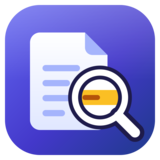
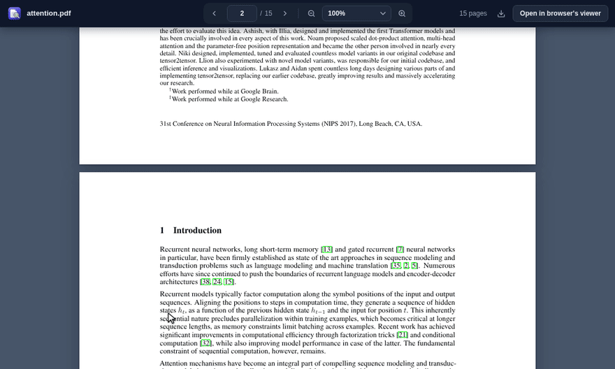
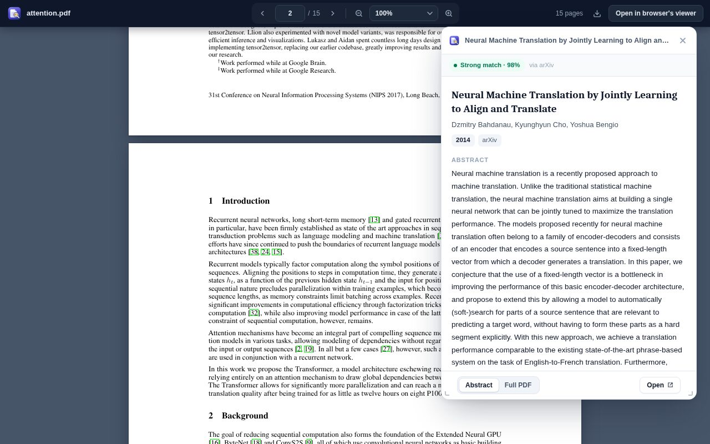
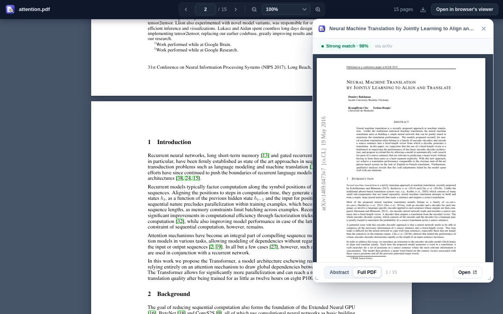
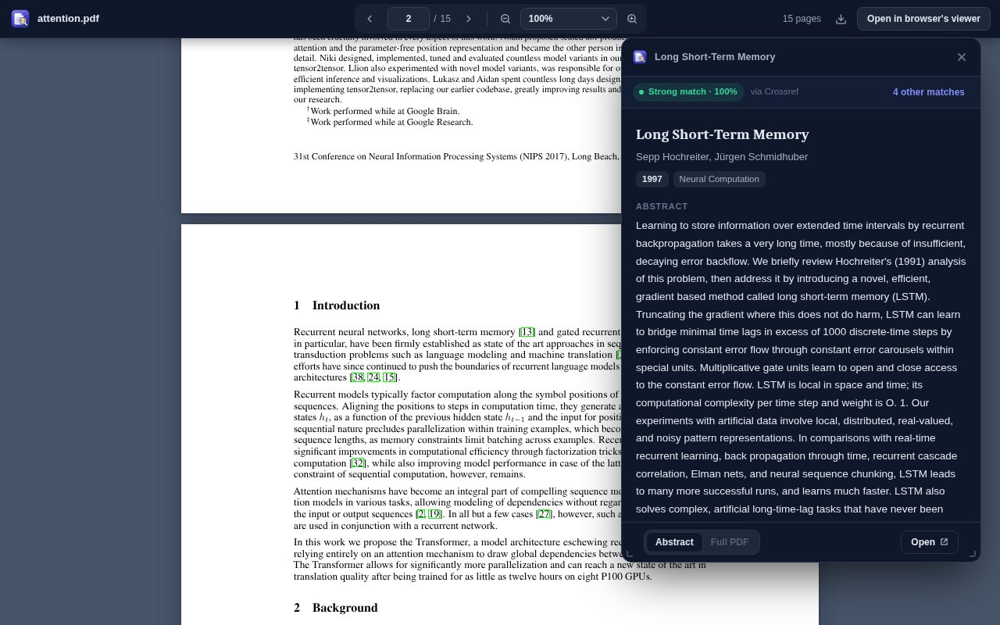
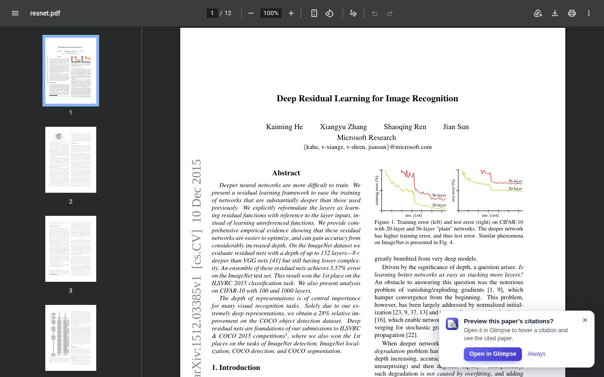
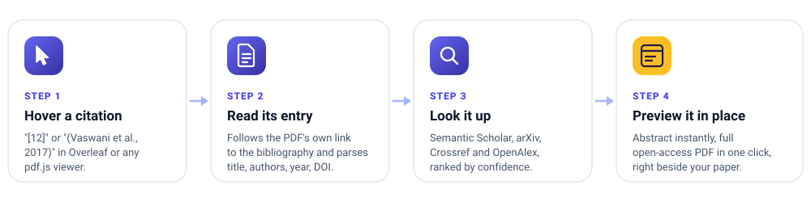

<p align="center">
  
</p>

<h1 align="center">Glimpse</h1>

<p align="center">
  <b>Hover a citation. See the paper. Keep reading.</b><br>
  Preview the papers a research paper cites — abstract or full PDF — without losing your place.
</p>

<p align="center">
  <a href="#install"></a>
  <a href="https://addons.mozilla.org/en-US/firefox/addon/glimpse-citation-preview-tool/"></a>
  <a href="#install"></a>
  <br>
  <a href="https://github.com/merfanian/glimpse/actions/workflows/ci.yml"></a>
  <a href="LICENSE"></a>
  <a href="PRIVACY.md"></a>
</p>

<p align="center">
  
</p>

---

Reading a paper means constantly jumping to the bibliography, copying a title into a search
engine, and losing your place. **Glimpse** puts the cited paper right next to the sentence
that cites it: hover a citation, click **Preview**, and read its abstract — or the full PDF —
in a floating panel.

## Features

<table>
  <tr>
    <td width="33%" valign="top">
      <br>
      <b>Preview in place</b><br>
      Hover <code>[12]</code> or <code>(Vaswani et al., 2017)</code>, click <i>Preview</i>, and the cited paper opens beside your text.
    </td>
    <td width="33%" valign="top">
      <br>
      <b>Finds the right paper</b><br>
      Reads the paper's own bibliography, then checks Semantic Scholar, arXiv, Crossref and OpenAlex — with a confidence score.
    </td>
    <td width="33%" valign="top">
      <br>
      <b>Abstract or full PDF</b><br>
      The abstract appears instantly; one click renders the open-access PDF, page by page.
    </td>
  </tr>
  <tr>
    <td valign="top">
      <br>
      <b>Works where you read</b><br>
      Overleaf, pdf.js-based viewers, and any PDF you open — Glimpse offers to open it in its own viewer.
    </td>
    <td valign="top">
      <br>
      <b>Made for long reading sessions</b><br>
      Drag and resize the panel, <kbd>Esc</kbd> to close, light and dark mode, and it remembers where you put it.
    </td>
    <td valign="top">
      <br>
      <b>Private by design</b><br>
      No account, no servers, no tracking. Only the citation you choose to preview is looked up.
    </td>
  </tr>
</table>

## Screenshots

<table>
  <tr>
    <td></td>
    <td></td>
  </tr>
  <tr>
    <td align="center"><sub><b>Abstract, authors and venue</b> with a match-confidence badge</sub></td>
    <td align="center"><sub><b>The full open-access PDF</b>, rendered page by page</sub></td>
  </tr>
  <tr>
    <td></td>
    <td></td>
  </tr>
  <tr>
    <td align="center"><sub><b>Dark mode</b>, following your system setting</sub></td>
    <td align="center"><sub><b>One click</b> from the browser's PDF viewer to Glimpse</sub></td>
  </tr>
</table>

## Install

| Browser | Install |
| --- | --- |
|  | Chrome Web Store — *in review, link coming soon* |
|  | **[Get Glimpse for Firefox](https://addons.mozilla.org/en-US/firefox/addon/glimpse-citation-preview-tool/)** |
|  | Edge Add-ons — *in review, link coming soon* |

Until the Chrome and Edge listings are live, download `glimpse-chrome.zip` or
`glimpse-edge.zip` from the [latest release](https://github.com/merfanian/glimpse/releases)
and [load it unpacked](#load-unpacked), or [build it from source](#development).

## Using Glimpse

1. **Open a paper.** Overleaf and pdf.js-based viewers work directly. For a PDF in the
   browser's own viewer (e.g. `arxiv.org/pdf/…`), accept the *Open in Glimpse* suggestion,
   or click the Glimpse toolbar button → **Open this PDF in Glimpse**.
2. **Hover a citation** and click **Preview**.
3. **Read** the abstract, or switch to **Full PDF**. *Open* takes you to the paper's page.

**Tips:** drag the panel by its header, resize it from either bottom corner, and press
<kbd>Esc</kbd> to close it. If the match isn't right, pick one of the *other matches*.
Right-click any PDF link → **Open PDF in Glimpse**, or drop a PDF onto the toolbar popup.

**When a PDF opens in the browser's own viewer** — where extensions can't run — choose what
happens in the popup:

| Setting | Chrome & Edge | Firefox |
| --- | --- | --- |
| **Suggest** (default) | A small *Open in Glimpse* card over the PDF | A Glimpse button in the address bar |
| **Always** | Opens in Glimpse automatically | Opens in Glimpse before the PDF renders |
| **Off** | Use the toolbar button when you want Glimpse | Same |

Downloads, PDFs returned by form submissions and embedded PDFs are never touched. In
Glimpse's viewer, **Open in browser's viewer** goes back (e.g. to print or fill a form).

## How it works

<p align="center">
  
</p>

Most LaTeX papers link each citation to its bibliography entry. Glimpse follows that link
inside the PDF, reads the entry — handling numbered and author–year styles, two-column
layouts, entries that wrap across columns, and review copies with line numbers — and extracts
the title, authors, year, DOI and arXiv ID. It then queries the scholarly databases in
parallel, ranks the candidates, and shows the best match with a confidence badge. Weak
matches are offered as *possible matches* instead of being shown as the answer.

## Where it works

|  | Chrome | Edge | Firefox |
| --- | :---: | :---: | :---: |
| Overleaf PDF preview | ✅ | ✅ | ✅ |
| Websites using the pdf.js viewer | ✅ | ✅ | ✅ |
| PDFs in the browser's own viewer | ✅ via Glimpse's viewer | ✅ via Glimpse's viewer | ✅ via Glimpse's viewer |
| Local PDF files | ✅ (with file access, or pick the file) | ✅ (same) | ✅ pick or drop the file |

Glimpse needs the PDF to contain citation links, which almost all LaTeX/arXiv papers do. The
full-PDF preview needs an open-access copy; otherwise you get the abstract and a link to the
paper.

## Settings

Open the toolbar popup → ⚙ (or the extension's options page). Changes save automatically.

- **Opening PDFs** — Suggest / Always / Off, as above.
- **Preview** — show the abstract or the full PDF first.
- **Where Glimpse runs** — Overleaf and/or pdf.js-based websites.
- **Paper lookup** — choose Semantic Scholar, arXiv, Crossref and OpenAlex; an optional
  contact email gives Crossref/OpenAlex requests more reliable rate limits.

## Privacy

Glimpse has no servers, accounts, analytics or tracking. When you preview a citation, only
that bibliography entry is sent — directly from your browser — to the scholarly databases
above. Details in [PRIVACY.md](PRIVACY.md).

<details>
<summary><b>Troubleshooting</b></summary>

- **Nothing happens on a PDF** — it's probably in the browser's built-in viewer, which
  extensions can't access. Use the *Open in Glimpse* suggestion or the toolbar button.
- **Firefox: "Glimpse needs access to websites"** — click *Allow access* in the popup.
  Firefox lets you withhold site access from extensions, and Glimpse can't work without it.
- **No *Preview* button on a citation** — the PDF may lack citation links, or the link
  points to a section/figure rather than the bibliography.
- **The toolbar popup shows whether Glimpse is active** on the current page.
- For a bug report, build with `--dev` (see below) and include the `[Glimpse]` lines from the
  page's DevTools console.

</details>

## Load unpacked

**Chrome / Edge:** open `chrome://extensions` (or `edge://extensions`), enable
**Developer mode**, click **Load unpacked**, and select the unzipped folder (or `dist/chrome`).

**Firefox:** open `about:debugging#/runtime/this-firefox`, click **Load Temporary
Add-on…**, and select `manifest.json` inside the folder (or `dist/firefox`). Temporary
add-ons are removed when Firefox restarts.

## Development

Requires **Node 20.19+ or 22.12+**.

```bash
npm ci
npm run build:chrome     # -> dist/chrome   (Chrome Web Store, Edge Add-ons)
npm run build:firefox    # -> dist/firefox  (Firefox Add-ons)
npm test                 # unit tests (vitest)
npm run typecheck        # tsc --noEmit
npm run watch            # rebuild the Chrome target on change
node scripts/build.mjs --target=firefox --dev   # unminified, with [Glimpse] debug logs
```

<details>
<summary><b>Project layout</b></summary>

```
src/
  shared/        Types, messaging, settings, reference parsing, bibliography extraction
  content/       loader.ts — tiny script on every page that detects PDF viewers
                 index.ts  — full content script, injected only where needed
                 pageFetch.ts — bridge that runs in the page's own context
    panel/       Preact preview panel + lazy page-by-page PDF renderer (shadow DOM)
  background/    Lookup, ranking, PDF fetching, PDF-opening behaviour
    sources/     Semantic Scholar / arXiv / Crossref / OpenAlex clients
  viewer/        Glimpse's PDF viewer (pdf.js)
  popup/         Toolbar popup
  options/       Settings page
scripts/         esbuild build, icon rendering, packaging
assets/icons/    glimpse.svg + glimpse-small.svg → committed PNG icons (npm run icons)
docs/images/     README images
```

One Manifest V3 codebase builds for all three browsers; `scripts/build.mjs` writes the
per-browser manifest. Builds are deterministic — `npm ci && npm run build:firefox` reproduces
the published Firefox package byte-for-byte. All third-party code comes from npm (`pdfjs-dist`,
`preact`) and is bundled; nothing is downloaded at runtime.

</details>

<details>
<summary><b>Releases &amp; store publishing</b></summary>

CI type-checks, tests and builds every push and pull request. Pushing a version tag cuts a
release:

```bash
git tag v1.2.0 && git push origin v1.2.0
```

The release workflow builds all targets, attaches the zips to a GitHub Release, and — when the
repository secrets below are set — uploads the new version to each store. A store whose
secrets are missing is skipped.

| Store | Secrets |
| --- | --- |
| Chrome Web Store | `CHROME_EXTENSION_ID`, `CHROME_CLIENT_ID`, `CHROME_CLIENT_SECRET`, `CHROME_REFRESH_TOKEN` |
| Microsoft Edge Add-ons | `EDGE_PRODUCT_ID`, `EDGE_CLIENT_ID`, `EDGE_API_KEY` |
| Firefox Add-ons | `FIREFOX_JWT_ISSUER`, `FIREFOX_JWT_SECRET` |

Safari isn't built here; it needs Xcode (`xcrun safari-web-extension-converter dist/chrome`).

</details>

## License

[MIT](LICENSE)
